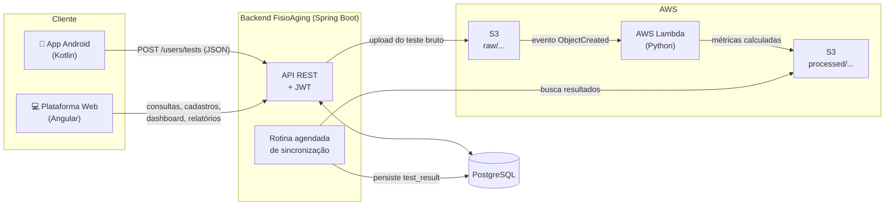
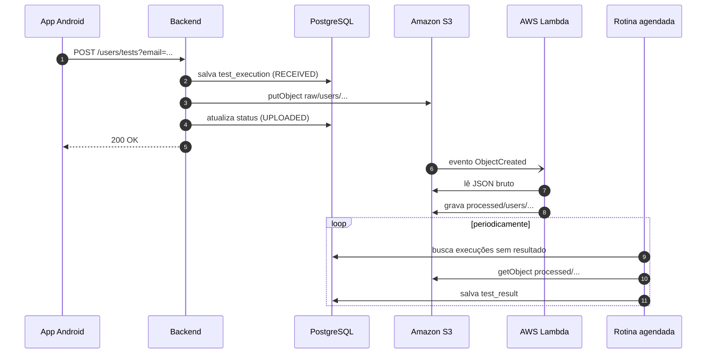
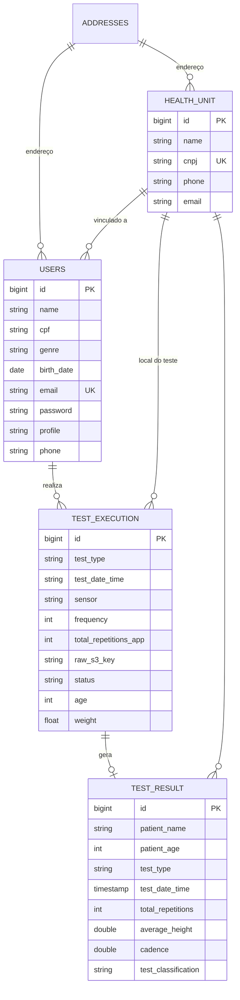

# FisioAging — Backend

> Sistema para realização dos testes **UTT** (*Unipedal Toe Test*) e **2MST** (*Two-Minute Step Test*) em idosos e análise dos resultados.

Trabalho de Conclusão de Curso do curso de Tecnologia em Análise e Desenvolvimento de Sistemas — Setor de Educação Profissional e Tecnológica (SEPT) da **Universidade Federal do Paraná (UFPR)**, desenvolvido em parceria com a Pós-graduação em Educação Física da UFPR e integrado ao ecossistema do projeto **TecnoAging**.


---

## Sumário

- [Contexto](#contexto)
- [Visão geral da solução](#visão-geral-da-solução)
- [Arquitetura](#arquitetura)
- [Fluxo de um teste](#fluxo-de-um-teste)
- [Tecnologias](#tecnologias)
- [Estrutura do projeto](#estrutura-do-projeto)
- [Modelo de dados](#modelo-de-dados)
- [API REST](#api-rest)
- [Processamento dos testes (AWS Lambda)](#processamento-dos-testes-aws-lambda)
- [Como executar](#como-executar)
- [Configuração](#configuração)
- [Deploy](#deploy)
- [Limitações e trabalhos futuros](#limitações-e-trabalhos-futuros)
- [Equipe](#equipe)

---

## Contexto

O envelhecimento populacional no Brasil é uma realidade crescente: segundo o Censo 2022 do IBGE, mais de 32,1 milhões de pessoas têm 60 anos ou mais (15,8% da população). Nesse cenário, a **fragilidade** — síndrome clínica marcada pela redução das reservas fisiológicas e pelo aumento da vulnerabilidade a quedas, hospitalizações e incapacidades — exige formas de avaliação precisas e acessíveis.

Testes funcionais simples como o **UTT** (elevação na ponta dos pés, que avalia força e resistência da panturrilha) e o **2MST** (marcha estacionária de dois minutos, que avalia resistência aeróbica) são amplamente usados, mas sua aplicação tradicional depende da observação direta do avaliador: os resultados são subjetivos, não ficam registrados de forma padronizada e não formam um histórico acessível.

O **FisioAging** substitui essa avaliação subjetiva por métricas calculadas a partir dos sensores inerciais do próprio celular (acelerômetro e giroscópio), armazenando os resultados em uma plataforma que permite o acompanhamento longitudinal de cada paciente, por diferentes profissionais e unidades de saúde.

## Visão geral da solução

A solução é composta por quatro partes:

| Módulo | Tecnologia | Responsabilidade |
|---|---|---|
| **Aplicativo mobile** | Android / Kotlin | Orienta o profissional na execução dos testes, captura os dados dos sensores e sincroniza os testes com o servidor |
| **Backend** *(este repositório)* | Java 21 / Spring Boot | Camada central: autenticação, cadastros, registro das execuções, envio ao S3, recuperação dos resultados, dashboard e relatórios |
| **Processamento** | Python / AWS Lambda | Limpa o ruído dos sinais e calcula as métricas de cada teste (repetições, cadência, altura média, etc.) |
| **Plataforma web** | Angular | Dashboard com indicadores, gestão de usuários e unidades de saúde, consulta dos testes e geração de relatórios |

Os scripts de processamento foram fornecidos pela Pós-graduação em Educação Física da UFPR e adaptados para execução na AWS.

## Arquitetura



## Fluxo de um teste

1. **Login** — o profissional de saúde se autentica no app (`POST /auth/login`) e recebe um token JWT.
2. **Seleção** — escolhe o paciente e o tipo de teste: *Marcha Estacionária* (2MST) ou *Elevação na Ponta dos Pés* (UTT).
3. **Execução** — o app exibe as instruções e um vídeo demonstrativo, e inicia a captura dos sensores:
   - **2MST**: 2 minutos de coleta (giroscópio e acelerômetro);
   - **UTT**: solicita o peso do paciente e coleta 30 segundos de acelerômetro e giroscópio.
4. **Armazenamento local** — ao finalizar, o teste é salvo no dispositivo em JSON (tipo, data/hora e leituras `time, x, y, z`), permitindo coleta mesmo sem conexão.
5. **Sincronização** — o profissional seleciona os testes pendentes e os envia ao backend (`POST /users/tests`).
6. **Upload para o S3** — o backend registra a execução (`status = RECEIVED`), grava o JSON bruto em `raw/users/{userId}/{tipo}/{execucaoId}_{dataHora}.json` e atualiza o status para `UPLOADED`.
7. **Processamento** — o upload dispara a AWS Lambda, que identifica o tipo de teste pelo caminho, aplica o pipeline correspondente e grava o resultado em `processed/...` (mesmo caminho, prefixo trocado).
8. **Recuperação** — uma rotina agendada do backend procura execuções sem resultado, lê o JSON processado no S3 e persiste o resultado na tabela `test_result`.
9. **Consulta** — os resultados ficam disponíveis no app e na plataforma web (dashboard, listagem, relatório individual e relatório em PDF).



## Tecnologias

**Backend**
- Java 21 e Spring Boot 4 (Web MVC, Data JPA, Security, Scheduling)
- Spring Security + JWT (`jjwt`) com senhas criptografadas em BCrypt
- PostgreSQL 17 com migrações versionadas via **Flyway**
- AWS SDK v2 (Amazon S3)
- OpenPDF para geração de relatórios
- Springdoc OpenAPI (Swagger UI)
- Lombok, Maven, Docker e Docker Compose

**Processamento**
- Python, NumPy, SciPy, pandas e scikit-learn (modelo pré-treinado para a marcha)
- AWS Lambda empacotada em imagem Docker, com `uv` para gerenciar dependências e `pytest` para testes

**Demais módulos:** Kotlin (Android) e Angular (web).

## Estrutura do projeto

```
backend/
├── src/main/java/com/core/fisioaging/
│   ├── config/          # Segurança (JWT, CORS), cliente S3, Jackson
│   ├── controller/      # Endpoints REST e tratamento global de exceções
│   ├── cronjob/         # TestResultSyncScheduler — rotina de recuperação de resultados
│   ├── data/            # DTOs de entrada e saída
│   ├── enums/           # Perfil, gênero e status de execução
│   ├── exception/       # Exceções de domínio
│   ├── mapper/          # Conversão entre models e DTOs
│   ├── model/           # Entidades JPA
│   ├── repository/      # Repositórios Spring Data e specifications de filtro
│   └── service/         # Regras de negócio (auth, usuários, unidades, upload, sync, dashboard, relatórios)
├── src/main/resources/
│   ├── application.properties
│   └── db/migration/    # Scripts Flyway
├── lambdas/processor/   # Função AWS Lambda de processamento (UTT + Marcha)
├── .github/workflows/   # CI: build e push da imagem Docker
├── docker-compose.yml
├── dockerfile
└── pom.xml
```

## Modelo de dados



**Perfis de usuário:** `Admin`, `Profissional` e `Paciente`.
**Status de uma execução:** `RECEIVED` → `UPLOADED` → `PROCESSING` → `PROCESSED` (ou `ERROR`).

## API REST

Base URL local: `http://localhost:8080`
Documentação interativa (Swagger UI): `http://localhost:8080/swagger-ui/index.html`

Com exceção das rotas públicas indicadas, todas as requisições exigem o cabeçalho:

```
Authorization: Bearer <token>
```

### Autenticação

| Método | Endpoint | Descrição | Público |
|---|---|---|:---:|
| `POST` | `/auth/login` | Autentica com e-mail e senha e retorna o token JWT | ✅ |

```json
// Requisição
{ "email": "maria.santos@email.com", "password": "Senha123" }

// Resposta
{ "token": "eyJhbGciOiJIUzI1NiIs...", "expiresIn": 3600, "userId": 1 }
```

### Usuários

| Método | Endpoint | Descrição | Público |
|---|---|---|:---:|
| `POST` | `/users` | Cadastra um usuário (paciente, profissional ou admin) | ✅ |
| `GET` | `/users/all` | Lista todos os usuários | ✅ |
| `GET` | `/users/{id}` | Consulta um usuário por ID | |
| `PUT` | `/users/{id}` | Atualiza um usuário | |
| `DELETE` | `/users/{id}` | Remove um usuário | |

<details>
<summary>Exemplo de corpo — <code>POST /users</code></summary>

```json
{
  "name": "João Carlos Oliveira",
  "cpf": "98765432100",
  "genre": "Masculino",
  "birthDate": "1962-09-25",
  "email": "joao.oliveira@email.com",
  "phone": "41988887777",
  "password": "Senha123",
  "profile": "Paciente",
  "address": {
    "streetName": "Rua XV de Novembro",
    "streetNumber": "980",
    "complement": "Casa",
    "city": "Curitiba",
    "state": "PR",
    "zipCode": "80060000",
    "neighborhood": "Centro"
  },
  "healthUnit": { "cnpj": "98765432000155" }
}
```

Valores aceitos — `genre`: `Masculino`, `Feminino`, `Outro`, `Prefiro não informar`; `profile`: `Admin`, `Profissional`, `Paciente`.
</details>

### Unidades de saúde

| Método | Endpoint | Descrição |
|---|---|---|
| `POST` | `/health-unit` | Cadastra uma unidade de saúde (CNPJ único) |
| `GET` | `/health-unit` | Lista as unidades de saúde |
| `GET` | `/health-unit/{id}` | Consulta uma unidade por ID |
| `PUT` | `/health-unit/{id}` | Atualiza uma unidade |
| `DELETE` | `/health-unit/{id}` | Remove uma unidade |

### Testes

| Método | Endpoint | Descrição |
|---|---|---|
| `POST` | `/users/tests?email={email}` | Recebe um teste do app, registra a execução e envia o JSON bruto ao S3 |
| `GET` | `/users/tests?email={email}` | Lista as execuções de testes de um paciente |
| `GET` | `/users/tests/{id}/result?email={email}` | Retorna o resultado processado de um teste |
| `DELETE` | `/users/tests/{id}?email={email}` | Remove uma execução de teste |

<details>
<summary>Exemplo de corpo — <code>POST /users/tests</code></summary>

```json
{
  "tipo_teste": "MARCHA",
  "data_hora": "20260604_143000",
  "sensor": "giroscopio",
  "frequencia": 50,
  "total_repeticoes_app": 18,
  "id_profissional": 8,
  "email_profissional": "ana.ferreira@clinica.com",
  "sexo": "Feminino",
  "idade": 68,
  "massa_kg": 72.5,
  "unidadeSaudeCnpj": "12345678000190",
  "registros": [
    { "time": 0,  "x": 0.12, "y": 0.45, "z": 0.81, "sensor": "giroscopio" },
    { "time": 20, "x": 0.18, "y": 0.51, "z": 0.76, "sensor": "giroscopio" }
  ]
}
```

- `tipo_teste` deve ser `UTT` ou `MARCHA`;
- `data_hora` e `registros` são obrigatórios;
- `time` é o tempo em milissegundos desde o início do teste.
</details>

### Dashboard e relatórios

| Método | Endpoint | Descrição |
|---|---|---|
| `GET` | `/dashboard/stats` | Indicadores agregados: total de pacientes, total de testes, testes por tipo, testes nos últimos 30 dias, etc. |
| `GET` | `/reports/test-results` | Gera um relatório **PDF** dos resultados de testes conforme os filtros |

Parâmetros de `/reports/test-results`: `startDate` e `endDate` (obrigatórios), `patientName`, `healthUnitId` e `patientAge` (opcionais).

```
GET /reports/test-results?startDate=2026-06-01&endDate=2026-06-30&healthUnitId=1
```

### Códigos de retorno

| Código | Significado |
|---|---|
| `200 OK` / `201 Created` | Operação concluída |
| `204 No Content` | Nenhum registro encontrado |
| `400 Bad Request` | Dados inválidos ou incompletos |
| `401 Unauthorized` | Credenciais inválidas ou token ausente/expirado |
| `404 Not Found` | Recurso não encontrado |
| `409 Conflict` | CPF, e-mail ou CNPJ já cadastrado |
| `500 Internal Server Error` | Erro inesperado no servidor |

## Processamento dos testes (AWS Lambda)

O diretório [`lambdas/processor`](lambdas/processor) contém uma única função Lambda que processa os dois testes. Ela é disparada por eventos `ObjectCreated` no prefixo `raw/users/` do bucket e escolhe o pipeline pelo segmento do caminho:

| Caminho no S3 | Pipeline | O que faz |
|---|---|---|
| `raw/users/{id}/utt/...` | `processor_utt.py` | Usa a aceleração linear para calcular deslocamento por ciclo e métricas como repetições totais e completas, altura média, cadência, amplitude máxima, tempo total, velocidade média e índice de estabilidade |
| `raw/users/{id}/marcha/...` | `processor_marcha.py` | Usa os dados do giroscópio, detecta os ciclos da marcha e aplica um regressor pré-treinado (`.joblib`) para calibrar a velocidade angular; calcula cadência, velocidades e variabilidade entre ciclos |

O resultado é gravado no mesmo caminho com o prefixo `processed/`. A função é **idempotente** (não reprocessa um arquivo que já tem resultado) e, em caso de falha, grava um arquivo `.error.json` ao lado do original.

Testes da função:

```bash
cd lambdas/processor
uv sync
uv run pytest -q
```

> O `scikit-learn` está fixado na versão 1.6.1 porque o modelo `.joblib` foi serializado nessa versão.

Mais detalhes sobre contratos de entrada e saída em [`lambdas/processor/README.md`](lambdas/processor/README.md).

## Como executar

### Pré-requisitos

- Docker e Docker Compose, **ou** Java 21 + Maven + PostgreSQL 17
- Um bucket S3 e credenciais AWS com permissão de leitura e escrita nele

### Com Docker Compose (recomendado)

```bash
git clone https://github.com/TCC-IDOSOS/backend.git
cd backend

cp .env.example .env    # preencha AWS_ACCESS_KEY_ID e AWS_SECRET_ACCESS_KEY

docker compose up --build
```

Sobem dois contêineres: `fisioaging-postgres` (porta `5432`) e `fisioaging-app` (porta `8080`). As migrações Flyway são aplicadas automaticamente na inicialização.

### Localmente com Maven

```bash
# banco de dados
docker compose up -d postgres

# credenciais AWS
export AWS_ACCESS_KEY_ID=...
export AWS_SECRET_ACCESS_KEY=...
export AWS_S3_BUCKET=fisioaging-tests
export AWS_S3_REGION=us-east-1

./mvnw spring-boot:run
```

### Testes

```bash
./mvnw test
```

## Configuração

| Variável / propriedade | Descrição | Padrão (dev) |
|---|---|---|
| `SPRING_DATASOURCE_URL` | URL JDBC do PostgreSQL | `jdbc:postgresql://localhost:5432/fisioaging` |
| `SPRING_DATASOURCE_USERNAME` / `_PASSWORD` | Credenciais do banco | `fisioaging` / `fisioaging` |
| `AWS_S3_BUCKET` | Bucket dos arquivos de teste | `fisioaging-tests` |
| `AWS_S3_REGION` | Região do bucket | `us-east-1` |
| `AWS_ACCESS_KEY_ID` / `AWS_SECRET_ACCESS_KEY` | Credenciais AWS (também aceita `~/.aws/credentials` ou IAM role) | — |
| `jwt.secret` | Chave de assinatura dos tokens JWT | definida em `application.properties` |
| `jwt.expiration` | Validade do token em ms | `86400000` (24 h) |
| `test-result.sync.fixed-delay-ms` | Intervalo entre execuções da rotina de recuperação de resultados | `300000` (5 min) se não definido |

> ⚠️ Em produção, defina `jwt.secret` e as credenciais do banco por variáveis de ambiente — os valores de `application.properties` servem apenas para desenvolvimento.

## Deploy

A cada push na branch `main`, o workflow [`deploy-docker.yml`](.github/workflows/deploy-docker.yml) gera a imagem Docker do backend (build multi-stage com Maven e JRE 21) e a publica no Docker Hub como `fisioaging-backend:latest`. São necessários os secrets `DOCKER_USERNAME` e `DOCKER_PASSWORD` no repositório.

## Limitações e trabalhos futuros

**Limitações atuais**
- O sistema ainda precisa de validação mais ampla em ambiente real, com profissionais de saúde e pacientes idosos.
- Diferentes modelos de smartphone podem apresentar variações na captação dos sensores, influenciando a precisão das medições.
- O processamento depende da disponibilidade dos serviços em nuvem e da execução dos scripts Python.
- A primeira versão contempla apenas os testes UTT e 2MST.

**Próximos passos**
- Validação prática com usuários finais (profissionais, pesquisadores e pacientes).
- Inclusão de novos protocolos de avaliação funcional e aprimoramento dos algoritmos de processamento.
- Monitoramento mais robusto da integração com a AWS (envio, processamento e retorno).
- Relatórios comparativos e acompanhamento longitudinal da evolução dos pacientes.
- Exportação de dados para pesquisas acadêmicas e integração com outras plataformas de saúde, respeitando os requisitos de segurança e proteção de dados (LGPD).

## Equipe

- Alan Patrick Konhevalic
- Ariane do Nascimento de Souza
- Cristhian Rodrigues Kindermann
- Natan Susin Cervinski
- Thales Assis de Oliveira

**Orientadora:** Profa. Dra. Rafaela Mantovani Fontana
**Banca:** Prof. Dr. Alessandro Brawerman

Monografia aprovada em 09 de junho de 2026 — Universidade Federal do Paraná, Curitiba/PR.
